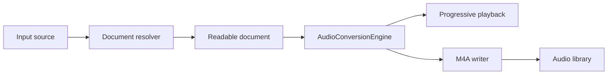

# Document Inputs

This document describes the implemented seam that extends Audio Monster from
“URL in, article out” to “narration document in, audio out” while preserving the
existing streaming synthesis, progressive playback, and library behavior.

## Current seam

The synthesis side is already the correct shared pipeline:



`AudioConversionEngine` consumes normalized title and narration text. The URL-
specific assumptions are now isolated behind the resolver and origin model:

- `ArticleExtracting` remains the web-specific adapter.
- `ReadableArticle` is retained as a compatibility name for the generalized
  readable-document value.
- `ConversionJob`, audio metadata, and persistence carry an origin, emitting URL
  metadata only for web documents.

Parsers do not know about Kokoro, playback, SwiftUI, or save-folder
coordination, and the synthesis engine does not know whether text came from
WebKit, a file, or the clipboard.

## Proposed domain model

Replace the URL-shaped article model with a URL-optional narration document:

```swift
public enum ReadableDocumentOrigin: Equatable, Sendable {
    case web(sourceURL: URL, resolvedURL: URL)
    case file(displayName: String, fileType: String)
    case pasted
}

public struct ReadableDocument: Equatable, Sendable {
    public let origin: ReadableDocumentOrigin
    public let title: String
    public let text: String
}
```

`ReadableDocument` is the only value passed to `AudioConversionEngine`. The
origin is also carried through `ConversionJob` and `AudioPersistenceRequest`.
Only the web case emits URL metadata or Finder “Where from” metadata; local
paths and pasted content must never leak into exported audio metadata.

The old `ReadableArticle` name can remain as a source-compatible type alias for
one migration cycle, but new APIs should use `ReadableDocument`.

## Resolver boundary

The application should have one input enum and one resolver protocol:

```swift
enum NarrationInput: Sendable {
    case web(URL)
    case file(URL)
    case pasted(title: String?, text: String)
}

@MainActor
protocol DocumentResolving: AnyObject {
    func resolve(_ input: NarrationInput) async throws -> ReadableDocument
}
```

`NativeDocumentResolver` becomes the composition point. It delegates web input
to the existing `NativeArticleExtractor`, selects a file parser by Uniform Type
Identifier, and normalizes pasted text. `AppModel` should have one
`startConversion(input:)` method; URL submit, file-open, and paste actions only
construct different `NarrationInput` values.

This keeps the orchestration DRY:

1. resolve input;
2. create one `ReadableDocument` and one job;
3. chunk and synthesize;
4. write metadata from origin;
5. persist and refresh the library.

There should not be separate “web conversion”, “file conversion”, and “paste
conversion” pipelines.

## Parser adapters

The current parser set is intentionally small:

| Format | Adapter | Initial policy |
| --- | --- | --- |
| Plain text | Foundation string reader | UTF-8 first, bounded input, filename-derived title |
| Markdown | Bounded Foundation reader and text projector | Speak headings, paragraphs, lists, quotes, and inline content; omit markup punctuation and fenced-code noise |
| RTF/RTFD | Foundation/AppKit attributed-string reader | Convert to plain narration text |
| PDF | PDFKit adapter | Read page text in order; report an explicit “no text layer” error for scans |
| HTML | Existing Readability adapter | Reuse the current rendered/local HTML projection policy |
| DOCX | Not yet supported | Report the format as unsupported rather than guessing |
| Legacy `.doc` | Not yet supported | Add only after a reliable native importer is selected and tested |

The current Markdown adapter deliberately stays dependency-free: it projects
common headings, lists, quotes, links, images, inline code, emphasis, and fenced
code into narration text. A structured Markdown AST remains a possible future
upgrade if richer syntax support becomes important. PDFKit is already an Apple
framework with `PDFDocument` URL/data initializers
and page text selections: [PDFDocument](https://developer.apple.com/documentation/pdfkit/pdfdocument).
For a future DOCX adapter, ZIPFoundation is a suitable low-level dependency for
reading an OOXML container, but it should read selected entries directly rather
than extracting an untrusted archive wholesale: [ZIPFoundation](https://github.com/weichsel/ZIPFoundation).

The parser protocol should return the same intermediate result regardless of
format:

```swift
protocol DocumentParsing: Sendable {
    func parse(fileURL: URL, displayName: String) async throws -> ReadableDocument
}
```

Format detection belongs in a registry, not in each parser and not in
`AppModel`. A parser can advertise supported UTTypes/extensions and the
registry chooses exactly one adapter.

## Paste experience

Paste should be a real text-editor mode, not a second oversized single-line
field:

- a “Paste text” action opens a `TextEditor` sheet;
- the sheet has an optional title and a “Use Clipboard” action;
- submission calls the same `startConversion(input:)` method as every other source;
- empty or whitespace-only input is rejected before a job is created;
- pasted text gets a deterministic title such as “Pasted text” when no title is supplied.

The existing URL field remains fast for the primary workflow, while the source
actions make the expanded input model discoverable.

## File access and safety

Document files are untrusted input. The file-open adapter should obtain
security-scoped access only for the duration of reading, then retain display
metadata rather than the user’s file URL in the job or audio artifact.

Every parser should enforce bounded work before parsing:

- maximum source file size and maximum decoded text size;
- cancellation checks between pages, ZIP entries, and XML elements;
- no shelling out to `textutil` or another process for the first implementation;
- no network access from a local-file parser;
- no external XML entities or DTD processing;
- ZIP entry-name validation against absolute paths and `..` traversal;
- an allowlist of DOCX entries, entry-count limits, and uncompressed-size limits;
- temporary parser state removed on success, failure, and cancellation.

For DOCX specifically, parse `word/document.xml` first, then add headers,
footers, footnotes, and endnotes only when fixtures demonstrate the desired
reading order. Never recursively extract the whole archive just to find one
document part.

## Implementation status and next steps

The first four stages are implemented: the generalized document/origin model,
shared conversion path, pasted text, and bounded plain text/Markdown/RTF/RTFD/PDF
adapters. The next staged extension is DOCX with adversarial ZIP/XML fixtures;
legacy `.doc` should remain deferred until a reliable native importer is
available on the supported macOS versions.

## Tests that define the seam

- All input kinds reach the same fake `AudioConversionEngine` in `AppModel` tests.
- Every parser produces equivalent title/text semantics for representative fixtures.
- Web origins preserve safe source/resolved URL metadata.
- File and pasted origins produce no local path, clipboard content, or synthetic
  URL in exported metadata.
- Markdown, PDF, and pasted-text fixtures cover empty input and cancellation.
- Sparse oversized-file, decoded-text, symlink, malformed-document, and PDF
  no-text-layer cases fail closed before narration begins.
- Existing progressive playback and library tests remain unchanged in behavior.
